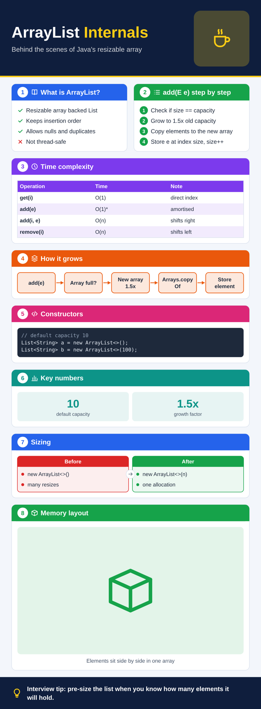
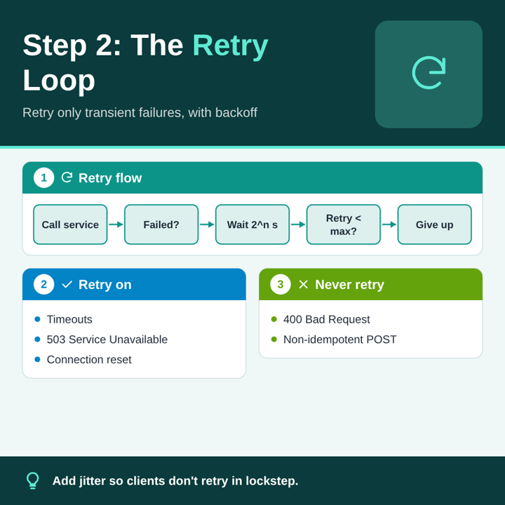

# Image and video generation pipeline

Status: proposed 2026-10-26 (Krishna asked to rework Generate Image and Generate Video to follow
his example flow). Implemented in small PRs into `f-mobile-app`; see [Rollout](#rollout).

## The flow Krishna asked for

```
Technical topic
      │
      ▼
LLM generates content
      │
      ▼
Structured JSON definition
      │
      ▼
Infographic renderer
      ├──────────────────────┐
      ▼                      ▼
SVG diagrams           AI-generated illustrations
      │                      │
      └──────────┬───────────┘
                 ▼
        High-resolution PNG
```

Video uses the same pipeline: the LLM writes a deck of slide definitions, each slide goes through
the renderer and the illustration step, and the PNGs are encoded into the slideshow MP4 (Q-08).

## The current flow and its problems

| Feature | Today | Problem |
|---|---|---|
| Generate Image | `GenerateImagesUseCase` puts the topic and 3 few-shot examples into `prompts/image.md` and asks the image agent for 4 finished images. Gemini paints them; Claude writes a whole SVG (`prompts/image_svg.md`, 16k tokens) that AndroidSVG draws. | Diffusion models misspell and blur the dense text a cheat sheet needs. The LLM never plans the content, so facts and structure vary. Claude's full SVG is slow and often cut off or overflowing, because the model has to do layout and text measuring itself. |
| Generate Video | `GenerateVideoUseCase` asks the image agent for 4 separate slides (`prompts/video.md`), then `Media3SlideshowMaker` encodes them. | The 4 calls don't know about each other, so slides repeat or skip steps and the style changes between slides. |

## New design

### 1. LLM generates content → structured JSON

The **text agent** (Claude, Gemini or Groq, the user's default) gets the topic and a system prompt
(`prompts/infographic.md`, with the few-shot examples from `image_examples.md` as content and layout
ideas) and replies with one JSON object. Video uses `prompts/video_deck.md` and replies with a deck.
The model only decides *what* to say and which building blocks to use; it never writes coordinates.

### 2. JSON definition (schema v1)

```jsonc
{
  "title": "ArrayList Internals",           // required, short
  "highlight": "Internals",                 // words of the title drawn in the highlight colour
  "subtitle": "Behind the scenes of Java's resizable array",
  "format": "portrait",                     // portrait (tall cheat sheet) | square | landscape (3:2)
  "palette": "navy",                        // navy | teal | purple | sunset | forest | dark
  "icon": "coffee",                         // built-in icon for the header (list below)
  "hero": "flat illustration of a coffee cup on a stack of boxes", // AI illustration for the header
  "sections": [                             // up to 8 numbered cards
    {"heading": "What is it?", "icon": "book", "type": "bullets",   "items": ["…"]},
    {"heading": "add(e)",                      "type": "steps",     "items": ["…"]},
    {"heading": "Use it when",                 "type": "pros_cons", "pros": ["…"], "cons": ["…"]},
    {"heading": "Constructors",                "type": "code",      "language": "java", "code": "…"},
    {"heading": "Cost",                        "type": "table",     "columns": ["Op", "Time"], "rows": [["get", "O(1)"]]},
    {"heading": "How it grows",                "type": "flow",      "nodes": ["add", "full?", "grow 1.5x", "copy"]},
    {"heading": "Sizing",                      "type": "compare",   "left": {"label": "Before", "items": ["…"]}, "right": {"label": "After", "items": ["…"]}},
    {"heading": "Key numbers",                 "type": "stats",     "items": [{"value": "1.5x", "label": "growth"}]},
    {"heading": "Memory layout",               "type": "illustration", "prompt": "…", "caption": "…"}
  ],
  "takeaway": "Interview tip: pre-size the list when you know its size."
}
```

Video deck: `{"palette": "teal", "slides": [ <definition>, … ]}` with 3 to 6 slides. Every slide is
square and uses the deck's palette, so the video looks consistent.

Built-in icons: database, server, cloud, user, lock, key, gear, check, cross, bolt, clock, chart,
code, globe, queue, layers, plug, shield, rocket, warning, idea, book, search, mobile, network,
arrow, box, target, star, chat, coffee, terminal, retry, cpu, list.

Parsing is lenient (`parseInfographic`, `parseSlideDeck`): it finds the JSON object in the reply,
ignores unknown fields, turns unknown section types with `items` into bullets, drops empty
sections and cuts lists to fixed limits. A reply with no JSON or no title fails, and the use case
retries the LLM once before reporting an error.

### 3. Infographic renderer

`InfographicRenderer` (pure Kotlin, unit-tested on the JVM) turns a definition into SVG that
AndroidSVG can draw:

- **Header band**: title (highlighted words in the accent colour), subtitle, and the hero
  illustration slot or the built-in icon on the right.
- **Cards**: numbered, rounded cards with a coloured header tab and icon, in 2 columns (3 for
  landscape). Narrow cards go into the shortest column; tables, flows, comparisons and long code
  span the page. Leftover cards share a full-width row so there are no holes.
- **Diagrams drawn in SVG**: bullet and numbered lists, check/cross lists, syntax-tinted code
  blocks, tables with a header row and striped rows, flow charts with arrows that wrap onto more
  rows, before/after panels, big-number stat tiles.
- **Footer**: the takeaway on a dark band with a light-bulb icon.
- Text is wrapped by measuring it (`TextMeasurer`; on the device it measures with the real font
  through `Paint`), since SVG text doesn't wrap. Short content is padded to the format; long
  content makes a portrait image taller.

Renderer output for a sample definition, before illustrations are painted in (the tinted panels
with icons are the illustration slots):

 

The renderer returns the SVG, its size, and the **illustration slots** (rectangle + prompt). Each
slot already holds a tinted placeholder with an icon, so the SVG is a complete image on its own.

### 4. AI-generated illustrations

For each slot, the **image agent** for that purpose (Gemini, or the new Hugging Face, Cloudflare
and Pollinations agents from PR #56; Claude draws a small SVG) gets a short prompt:
the slot's prompt plus a fixed style suffix (*flat vector illustration, the palette's colours,
plain background, no text, no letters, no logos*). Illustrations never carry text, which is what
diffusion models are bad at. At most 2 slots per image (hero + one card) and 1 per video slide keep
the number of calls close to today's. Calls run in parallel; a failed illustration keeps its
placeholder instead of failing the image. With no image agent set up, images still work from the
text agent alone.

### Output size

The sample images in `requirements/linkedin-posts-sample-images/` are 1024 x 1536 (2:3 portrait,
most of them), 1536 x 1024 (3:2 landscape) and 800 to 1536 square. Infographics are laid out at
1080 x 1620 (portrait, taller when the content needs it), 1080 x 1080 (square) and 1620 x 1080
(landscape), and drawn at 2x: **2160 x 3240, 2160 x 2160 and 3240 x 2160 px** at least, larger
than every sample and never a phone-screen size such as 9:16 or 4:5.

### 5. Merge → high-resolution PNG

`InfographicComposer` (Android): AndroidSVG draws the SVG onto a bitmap at 2x (2160 px wide for
portrait and square, 3240 for landscape). Each illustration is decoded, centre-cropped to its slot
and drawn over the placeholder, clipped to the slot's rounded corners. The bitmap is saved as PNG
in `MediaCache`. Height is capped (8000 px) to protect memory.

### 6. Video

`GenerateVideoUseCase` asks the text agent for one deck (`prompts/video_deck.md`, with the same few-shot examples), renders and composes each slide the same
way (square, at 1080 px since that is the video's size, one illustration per slide), then `Media3SlideshowMaker` encodes them as before. One LLM call plans the
whole story, so the slides follow on from each other and share a style.

### What happens to the old flow

The direct "image agent paints the whole infographic" flow stays as the fallback when no text agent
is set up, so existing setups with only a Gemini key keep working. `image.md` and
`image_examples.md` stay in use (the examples now feed the infographic prompt). `image_svg.md` is
replaced by a short illustration prompt for Claude.

## Rollout

| PR | Content |
|---|---|
| 1 | This design, the JSON definition and parser, the renderer, built-in icons and palettes, unit tests. No change in the app yet. |
| 2 | `prompts/infographic.md`, `InfographicPipeline` (LLM → JSON → render → illustrations → compose), `PaintTextMeasurer`, `InfographicComposer`; Generate Image and Content & Image use it, with the old flow as fallback. |
| 3 | `prompts/video_deck.md`; Generate Video and Content & Video build slides through the pipeline. |

## Update 2026-10-27: no-limit content first

With a text agent set up, both pipelines now start with one extra call: the text agent writes in-depth technical content on the prompt with no length limit (`prompts/media_content.md`). The infographic definitions and the video deck are then planned from that content instead of the bare prompt, so images and slides carry the depth of a full write-up. See [requirements 14](../requirements/14-prompt-types-and-media-workflow.md).
