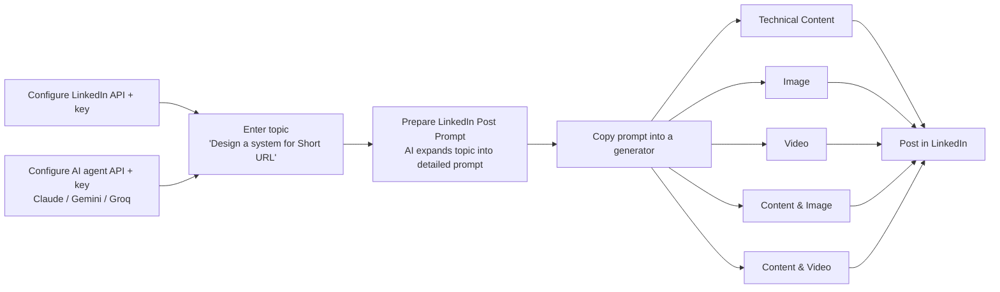

# 1. Product overview

Source: slides 1, 5, 12.

## Purpose

SM Assistant is a **mobile app** that acts as a personal assistant for producing and publishing social media content. The first (and, in the wireframes, only) target platform is **LinkedIn**.

The core idea: the user supplies a short topic, the app uses an AI agent to expand it into a high-quality prompt, then uses that prompt to generate post material (text, images, video, or combinations), and finally publishes the result to LinkedIn.

## Target user *(inferred)*

A software professional who posts technical content on LinkedIn (system design, Java/Spring topics). Slide 12 shows a real example post comparing `application.yml` and `application.properties` in Spring Boot, with a comparison table image; the worked example throughout the wireframes is "Design a system for Short URL".

## End-to-end workflow

1. **One-time setup** — enter LinkedIn API details and API key; enter API details and key for one or more AI agents.
2. **Prepare a prompt** — type a short topic; the assistant returns a detailed, role-based prompt (copyable).
3. **Generate** — paste/submit the prompt in one of five generators to get text, image(s), video, or a combination.
4. **Publish** — tap **Post in LinkedIn** on the result.

## In scope (per wireframes)

- LinkedIn integration settings (API + API key).
- AI agent settings for **Claude**, **Gemini** and **Groq** (API + API key each).
- Social Media Assistant hub with six features:
  1. Prepare LinkedIn Post Prompt
  2. Generate Technical Content
  3. Generate Image
  4. Generate Video
  5. Generate Content & Image
  6. Generate Content & Video
- Chat-style generation screens with prompt input, Submit, rendered result, copy/expand on prompt cards.
- One-tap posting of generated output to LinkedIn.

## Not shown in wireframes

Login/accounts, post history, drafts, scheduling, editing generated content before posting, other social networks, error/loading states. See [Open questions](09-open-questions.md).
