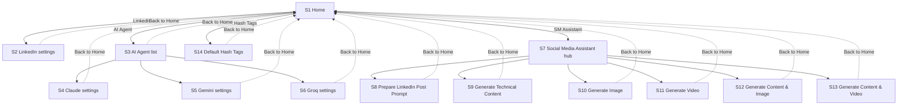

# 2. Screens and navigation

Source: slides 2–11.

## Screen inventory

| ID | Screen | Reached from | Key elements | Slide |
|----|--------|--------------|--------------|-------|
| S1 | **Home** | App launch | Buttons: *LinkedIn API*, *AI Agent*, *AI Agent* (duplicate label, see Q-01), *SM Assistant*, *Default Hash Tags* (new, see [10](10-default-hashtags.md)) | 2 (left) |
| S2 | **LinkedIn settings** | Home → LinkedIn API | Section chip *LinkedIn*; fields *LinkedIn APIs*, *LinkedIn API Key*; **SAVE**; **Back to Home** | 2 (right) |
| S3 | **AI Agent list** | Home → AI Agent | Section chip *AI Agent*; list: *Claude AI Agent*, *Gemini AI Agent*, *Groq AI Agent*; **Back to Home** | 3 (left) |
| S4 | **Claude AI Agent settings** | S3 → Claude AI Agent | Fields *Claude APIs*, *Claude API Key*; **SAVE**; **Back to Home** | 3 (right) |
| S5 | **Gemini AI Agent settings** | S3 → Gemini AI Agent | Fields *Gemini APIs*, *Gemini API Key*; **SAVE**; **Back to Home** | 4 (left) |
| S6 | **Groq AI Agent settings** | S3 → Groq AI Agent | Fields *Groq APIs*, *Groq API Key*; **SAVE**; **Back to Home** | 4 (right) |
| S7 | **Social Media Assistant hub** | Home → SM Assistant | Heading *Social Media Assistant*; six feature buttons | 5 (left) |
| S8 | **Prepare LinkedIn Post Prompt** | S7 | Chat area; input + **Submit**; **Back to Home** | 5 |
| S9 | **Generate Technical Content** | S7 | Chat area; input + **Submit**; result + **Post in LinkedIn**; **Back to Home** | 6 |
| S10 | **Generate Image** | S7 | As S9, result is image(s); full image preview | 7, 8 |
| S11 | **Generate Video** | S7 | As S9, result is video | 9 |
| S12 | **Generate Content & Image** | S7 | As S9, result is text + image(s) | 11 |
| S13 | **Generate Content & Video** | S7 | As S9, result is text + video | 10 |
| S14 | **Default Hash Tags** | Home → Default Hash Tags | Section chip *Default Hash Tags#*; multi-line hashtag box; **Save**, **Clear**; enable/disable toggle; **Back to Home** | [wireframe](wireframes/default-hashtags.png) |

## Navigation map

- Every screen except Home and the hub shows a full-width **Back to Home** button pinned to the bottom. The hub itself (slide 5, left) shows no Back to Home button in the wireframe *(probably an omission; see Q-02)*.
- There is no "back one level" control in the wireframes; **Back to Home** always returns to S1 *(as labelled)*.

## Common screen layout

Every screen is a phone-sized frame with:

1. **App bar** — blue, centred title "SM Assistant".
2. **Section chip** — yellow label naming the current screen/feature (e.g. "Claude AI Agent", "Generate Image"), left-aligned below the app bar.
3. **Body** — form fields (settings) or a scrollable chat/result area (features).
4. **Action area** — green **SAVE** (settings) or an input bar with a green **Submit** button (features).
5. **Footer** — black **Back to Home** button.

See [UI conventions](08-ui-conventions.md) for details.
