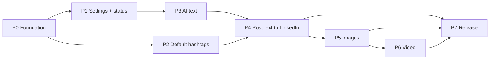

# SM Assistant — Implementation task breakdown

Tasks to implement every requirement in [`docs/requirements/`](../requirements/README.md) in the Android app (`android/`).
Status was first measured against `f-mobile-app` after PR #4 (Android skeleton, `app.yml` config, API Status screen, CI APK build) on 2026-10-25, and is updated by each implementation PR.

## How to read the task files

Each requirement ID (e.g. `HT-4`) has up to three kinds of task:

| Type | Prefix | Meaning |
|------|--------|---------|
| Implementation | `…-I` | Write the code that delivers the requirement. |
| Validation | `…-V` | Check the built app against the requirement and wireframe on a device/emulator, using the acceptance criteria listed. Done by a person (or a scripted UI walk-through) before the requirement is marked done. |
| Test | `…-T` | Automated tests that keep the requirement working: **unit** (JVM, `app/src/test`) or **UI** (Compose instrumented, `app/src/androidTest`). |

Status values: **done** (implemented and matches the requirement), **partial** (some code exists, gaps listed), **todo**, **blocked** (needs an answer to an open question first; an interim choice may let work start).

"Depends on" lists task IDs that must be finished first.

## Files

| File | Covers | Requirement IDs |
|------|--------|-----------------|
| [00-foundation.md](00-foundation.md) | Test setup, CI, architecture, secure storage, HTTP layer | NFRs from 03, 04 |
| [01-navigation-and-ui.md](01-navigation-and-ui.md) | Screens S1–S15, navigation, shared components, UI conventions | 02, 08 |
| [02-settings.md](02-settings.md) | LinkedIn and AI agent settings | LI-1…4, AG-1…5 |
| [03-api-status.md](03-api-status.md) | API Status screen | AS-1…6 |
| [04-default-hashtags.md](04-default-hashtags.md) | Default hashtags list, toggle, appending | HT-1…16 |
| [05-prepare-prompt.md](05-prepare-prompt.md) | Prepare LinkedIn Post Prompt | PP-1…7 |
| [06-content-generation.md](06-content-generation.md) | Shared generation, Technical Content, Image, Video, Content & Image, Content & Video | GEN-1…4, TC-1…3, IM-1…5, VI-1…3, CI-1…2, CV-1…2 |
| [07-post-to-linkedin.md](07-post-to-linkedin.md) | Post in LinkedIn | LP-1…5 |
| [08-scheduled-posts.md](08-scheduled-posts.md) | Scheduled LinkedIn posts | SC-1…10 |
| [09-prompt-types-and-media.md](09-prompt-types-and-media.md) | Prompt types and the image/video content workflow | PT-1…5, MW-1…4 |

## Phases

Phases are ordered so each one ships something usable and later phases build on earlier ones.

| Phase | Goal | Main tasks | Needs answers to |
|-------|------|-----------|------------------|
| **P0 Foundation** | Make the code testable and CI-checked before adding features | FND-1…8 | Q-14 (only for FND-4 long-term) |
| **P1 Settings and status hardening** | Finish and test what PR #4 started | NAV-*, UI-*, LI-*, AG-1…4, AS-* | Q-03, Q-04 (interim choices possible) |
| **P2 Default hashtags** | Fully local feature, no external APIs | HT-1…9, HT-10…14 logic | Q-17, Q-18 (interim choices in place) |
| **P3 AI text** | Agent clients and the two text features | AGC-*, GEN-1…4, PP-*, TC-1…2 | Q-05, Q-09, Q-11 |
| **P4 Post text to LinkedIn** | First end-to-end flow: topic → prompt → content → post | LP-1…5, TC-3, HT-10…16 wiring | **Q-03** (auth), Q-12 |
| **P5 Images** | Image generation and image posts | IM-*, CI-* | Q-10 |
| **P6 Video** | Video generation and video posts | VI-*, CV-* | Q-08 answered 2026-10-25: slideshow of generated diagrams |
| **P7 Release polish** | Accessibility, release build, signing | REL-* in [00-foundation.md](00-foundation.md) | Q-15 (iOS?) |

P1 and P2 can run in parallel once P0 is in.

## Status summary (after the saved-state PR)

| Area | Done | Partial | Todo | Blocked |
|------|------|---------|------|---------|
| Foundation (FND tasks) | 5 | 1 | 2 | 0 |
| Navigation & UI | 8 | 0 | 0 | 1 |
| Settings (LI, AG) | 11 | 0 | 0 | 1 |
| API Status (AS) | 6 | 0 | 1 | 0 |
| Default hashtags (HT) | 17 | 0 | 0 | 0 |
| Prepare prompt (PP) | 7 | 0 | 1 | 0 |
| Content generation | 20 | 0 | 1 | 0 |
| Post to LinkedIn (LP) | 7 | 0 | 0 | 0 |
| Scheduled posts (SC) | 12 | 0 | 0 | 0 |

Counts are per requirement row in each file (per task for Foundation). What's left: the optional rows waiting on Q-06, Q-22 and Q-23; the release tasks (REL-*); and the manual validation (`-V`) checks, which need a device. Unit and Robolectric UI tests run in CI on every PR.

## Defects found in the current code

| # | Where | Problem | Fixed by |
|---|-------|---------|----------|
| D-1 | `DefaultHashtagsScreen.kt` | ~~Toggle starts **on**; HT-8 says it starts **off** until the first non-empty save. Toggle and list aren't persisted.~~ Fixed. | HT-I2, HT-I3 |
| D-2 | `ApiSettingsStore` | ~~API keys are in plain `SharedPreferences` (excluded from backup, but not encrypted).~~ Fixed: encrypted with a Keystore key. | FND-4 |
| D-3 | `ApiSettingsForm` | ~~No validation for empty fields, and saving an empty API URL overwrites the `app.yml` default with `""`.~~ Fixed. | LI-2-I, AG-2-I |
| D-4 | `FeatureScreen` | ~~One generic screen for all six features with a TODO Submit.~~ Fixed: every feature has its own screen and `FeatureScreen` is gone. | GEN-*, PP-* |
| D-5 | `.github/workflows/android.yml` | ~~CI builds only; no unit tests or lint.~~ Fixed: CI runs lint and unit tests. | FND-2 |
| D-6 | Settings screens | ~~`model` from `app.yml` is loaded but can't be viewed or changed in the app.~~ Fixed: model dropdowns on the agent screens. | AG-6 (Q-04) |

## Blocked on open questions

| Question | Blocks | Interim choice so work can start | Hard block? |
|----------|--------|----------------------------------|-------------|
| Q-01 Duplicate AI Agent button | NAV-1 final layout | One button (already done) | No |
| Q-02 Back on hub / one-level back | NAV-3 | Back to Home on hub + system back pops one level (done) | No |
| **Q-03 LinkedIn auth** | LI-*, LP-1, LP-2, AS LinkedIn check | Answered 2026-10-25: Sign in with LinkedIn (OAuth, user's own developer app), pasted token as fallback | No (answered) |
| Q-04 What "APIs" holds; model choice | AG-6 | API = endpoint URL; model picked from the provider's live list (answered 2026-10-25) | No |
| Q-05 Which agent per feature | GEN-1, AGC-4 | Default agent setting + capability filter (text: any; image: Gemini) | No, but affects UI |
| Q-06 Prompt hand-off | PP-8 | Copy/paste only | No |
| Q-07 Hub vs Home | NAV-2 | Separate hub (done) | No |
| **Q-08 Video** | VI-*, CV-* | Answered: slideshow of Gemini diagrams encoded on the device | No (answered) |
| Q-09 Loading/error states | GEN-4 | Spinner + inline error card with Retry | No |
| Q-10 Image count / selection | IM-2, IM-5 | Up to 4 images, user can deselect | No |
| Q-11 Post format | TC-1, TC-3, LP-2 | Generators produce LinkedIn-ready text ≤ 3,000 chars | No, but changes prompts |
| Q-12 Preview/edit before posting | LP-6, HT-15 | Confirmation dialog showing final text | No |
| Q-13 Storage of conversations | GEN-5 | In-memory only per screen | No |
| Q-14 Direct calls vs backend | FND-4, all API clients | Direct calls from the device | No (rework if backend chosen) |
| Q-15 Platforms | REL-* | Android only | No |
| Q-16 Accounts | — | Single-user, no login | No |
| Q-17 Toggle location | HT-7 | On the Default Hash Tags screen (done) | No |
| Q-18 Clear behaviour | HT-5 | Clear empties the box only | No |
| Q-19 Per-post skip | HT-17 | Global toggle only | No |
| Q-20 AI-suggested hashtags | HT-20-I | Built behind a toggle (2026-10-25) | No |
| Q-21 LinkedIn status endpoint | AS-3 LinkedIn | Keep `/v2/userinfo`, show No access | No |
| Q-22 Test button on settings | AS-7 | Not built | No |
| Q-23 Warn when agent not Connected | GEN-6 | Not built | No |

## Traceability

Every requirement ID in `docs/requirements/` appears in exactly one task file:
LI-1…4 and AG-1…5 in 02, AS-1…6 in 03, HT-1…16 in 04, PP-1…7 in 05, GEN-1…4 / TC / IM / VI / CI / CV in 06, LP-1…5 in 07.
Screen IDs S1–S15 and the UI conventions are in 01. Inferred NFRs (secure storage, never log keys, generic agent screen) are in 00 and 02.
IDs not in the requirements (FND, NAV, UI, AGC, REL, AG-6, AS-7, PP-8, GEN-5/6, LP-6, HT-17) are new tasks this plan adds; each says which question or NFR it comes from.
