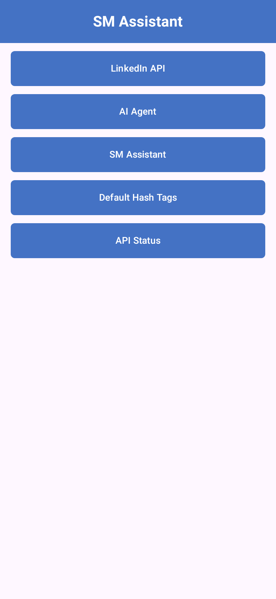
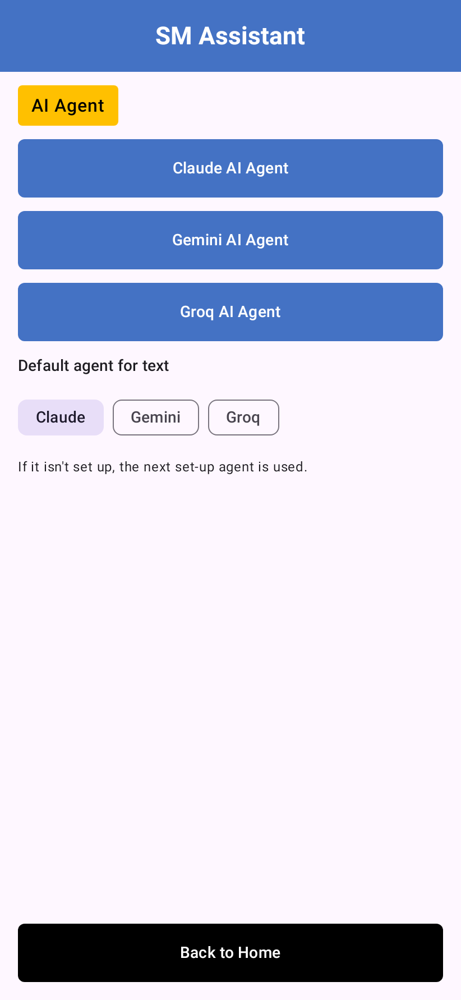
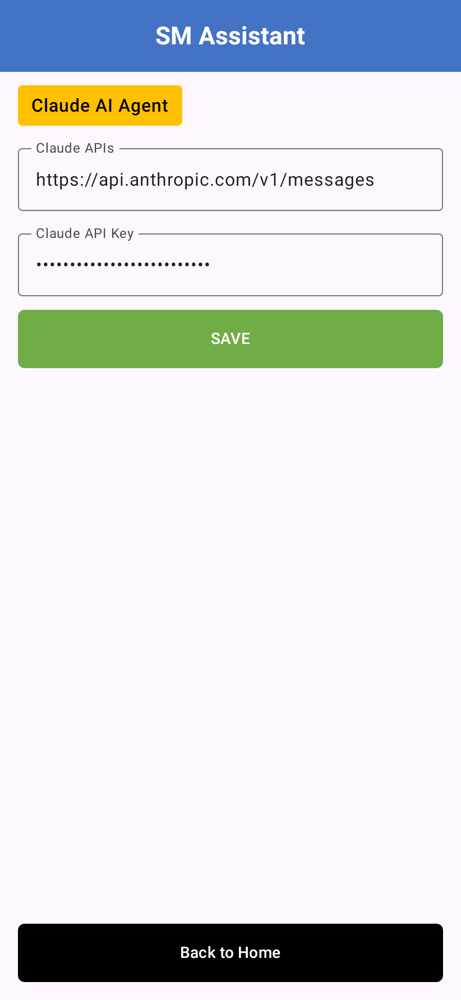
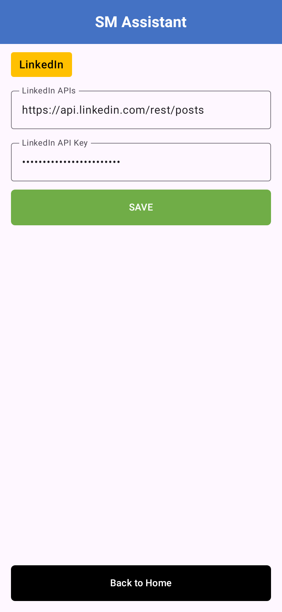
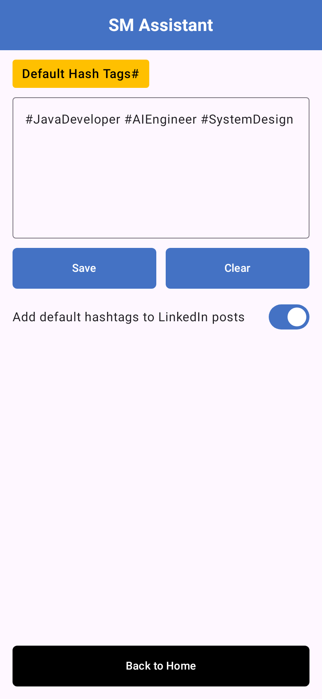
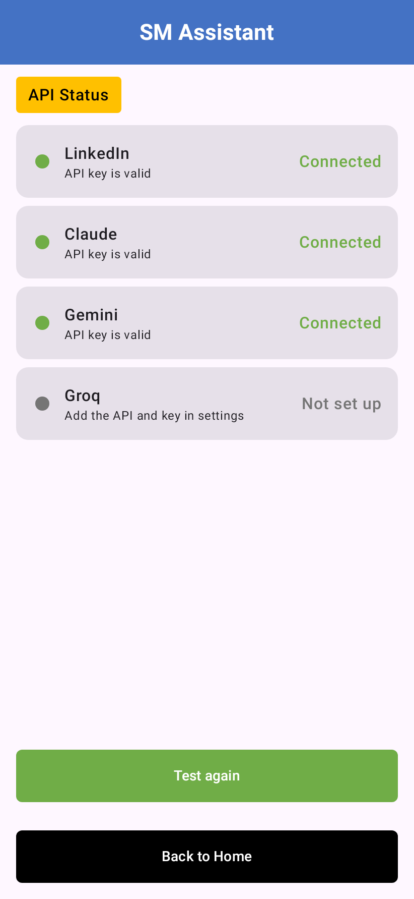
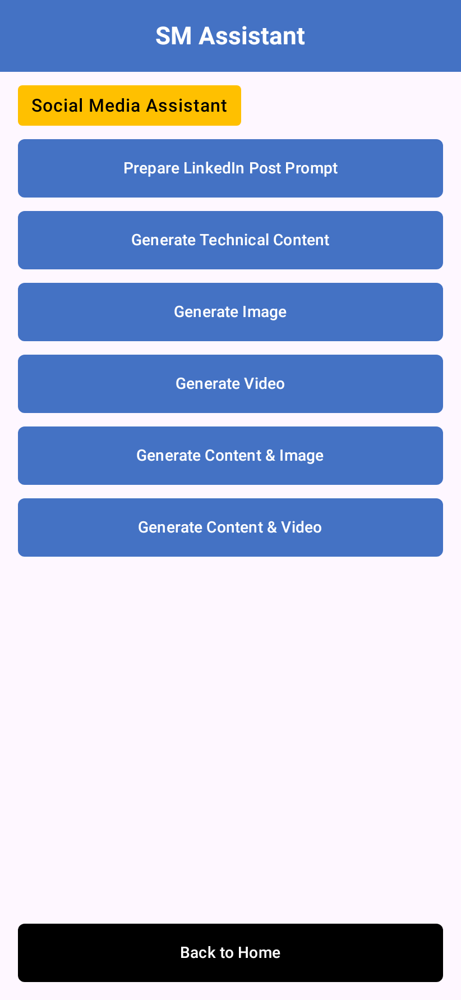
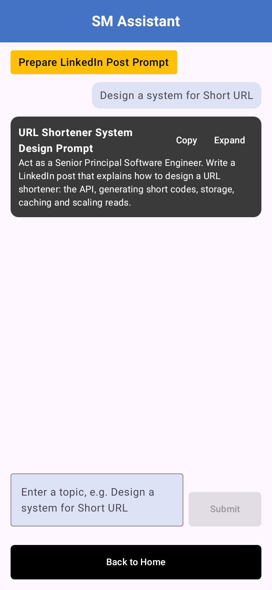
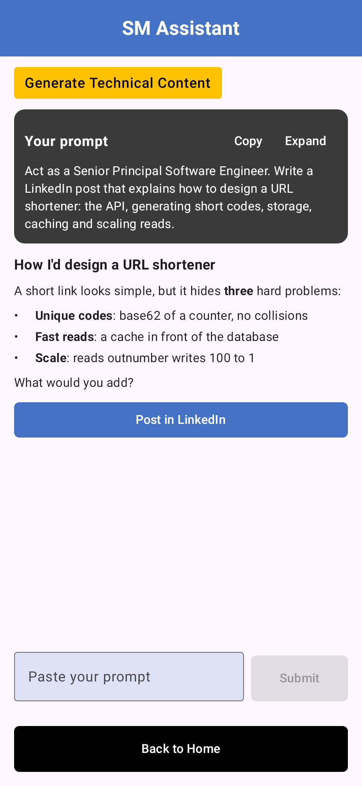
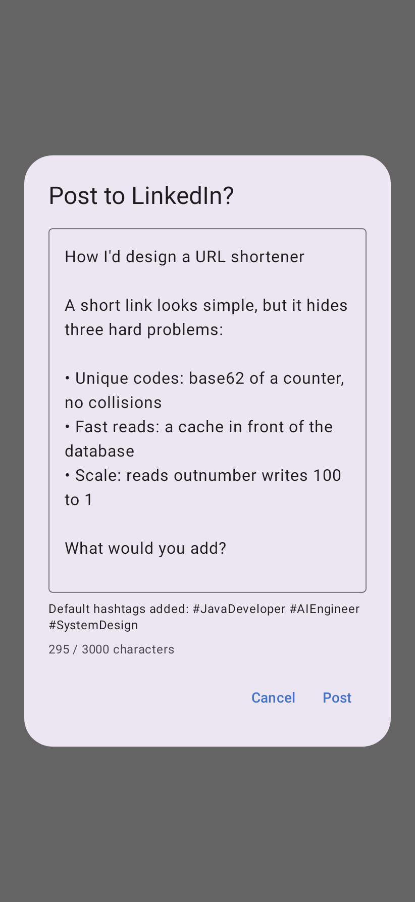

# SM Assistant: set up the app on your phone

This guide takes you from installing the app to publishing your first LinkedIn post. It takes
about 15 minutes, most of it spent creating API keys.

You need:

- An Android phone with Android 8.0 or newer.
- At least one AI key: **Claude** (Anthropic), **Gemini** (Google) or **Groq**. Gemini is the
  one that makes images and videos, so add it if you want those.
- A **LinkedIn access token**, if you want to post from the app.

The screenshots are rendered from the app's own screens by CI (see
[Updating the screenshots](#updating-the-screenshots)). The keys in them are fake.

## 1. Install the app

The app isn't on the Play Store. You install the APK that GitHub Actions builds.

1. On GitHub, open the repository's **Actions** tab and pick **Android build**.
2. Open the latest green run on the `main` branch.
3. Under **Artifacts**, download **app-debug**. You must be signed in to GitHub to download it.
   It's a zip file: unzip it to get **app-debug.apk**. If you downloaded it on a computer, copy
   the APK to the phone (USB cable, Google Drive, or email it to yourself).
4. On the phone, tap the APK file (in **Files** › **Downloads**, or in the browser's downloads).
5. Android asks to allow installs from this source the first time. Tap **Settings**, turn on
   **Allow from this source** for the app you opened the file with (Chrome, Files, Drive…),
   then go back and tap **Install**.
6. If Play Protect warns that the app is from an unknown developer, tap **More details** ›
   **Install anyway**. This is expected for a debug build that isn't on the Play Store.

To update later, install the newer APK the same way. Your keys and settings are kept.

> If Android says the app "conflicts with an existing package", uninstall the old SM Assistant
> first. That happens when two APKs were signed by different CI machines.

## 2. The Home screen

Open **SM Assistant**. Every setup screen starts from Home, and **Back to Home** at the bottom of
each screen brings you back here.



Set the app up in this order: **AI Agent**, **LinkedIn API**, **Default Hash Tags**, then check
everything on **API Status**.

## 3. Add your AI keys

### Get a key

| Agent | Where to get the key | Looks like | Used for |
|---|---|---|---|
| Claude | [console.anthropic.com](https://console.anthropic.com/settings/keys) › API Keys › Create Key | `sk-ant-…` | Text |
| Gemini | [aistudio.google.com/apikey](https://aistudio.google.com/apikey) › Create API key | `AIza…` | Text, images, video |
| Groq | [console.groq.com/keys](https://console.groq.com/keys) › Create API Key | `gsk_…` | Text |

Copy the key when it's shown. Most consoles show it only once.

### Enter it in the app

1. On Home, tap **AI Agent**.

   

2. Tap the agent, for example **Claude AI Agent**.
3. Leave **Claude APIs** as it is. It's already filled with the right address.
4. Paste your key into **Claude API Key**. It shows as dots.
5. Tap **SAVE**. A "Claude settings saved" message appears.

   

Repeat for each agent you have a key for. Each agent uses the model set in the app's defaults
(Claude Sonnet 5.5, Gemini 2.5 Flash with Gemini 2.5 Flash Image for pictures, and Llama 3.3 70B
on Groq).

### Choose the default agent for text

Back on the **AI Agent** screen, **Default agent for text** picks which agent writes posts and
prompts first. If that agent has no key, the app uses the next one that is set up.

## 4. Connect LinkedIn

The app posts with a LinkedIn **access token** that you paste in. (A "Sign in with LinkedIn"
button may replace this later.)

### Get a token

1. Go to [linkedin.com/developers/apps](https://www.linkedin.com/developers/apps) and create an
   app (any name; it needs a LinkedIn Page, which can be one you create for this).
2. On the app's **Products** tab, add **Share on LinkedIn** and **Sign In with LinkedIn using
   OpenID Connect**.
3. Open the [OAuth token generator](https://www.linkedin.com/developers/tools/oauth/token-generator),
   pick your app, and tick the scopes **openid**, **profile** and **w_member_social**.
4. Tap **Request access token**, sign in, allow access, and copy the token.

The token lasts about 60 days. When it expires, posting fails with "LinkedIn token expired or
invalid"; generate a new one and paste it in again.

### Enter it in the app

1. On Home, tap **LinkedIn API**.
2. Leave **LinkedIn APIs** as `https://api.linkedin.com/rest/posts`.
3. Paste the token into **LinkedIn API Key** and tap **SAVE**.



## 5. Set default hashtags (optional)

Hashtags saved here are added to the end of every LinkedIn post.

1. On Home, tap **Default Hash Tags**.
2. Type your tags, separated by spaces, commas or new lines. A missing `#` is added for you.
3. Tap **Save**.
4. Turn on **Add default hashtags to LinkedIn posts**. Turn it off any time to post without them.



**Clear** empties the box; the saved tags only change when you tap **Save** afterwards.

## 6. Check everything on API Status

On Home, tap **API Status**. The app tests each API with the key you saved.



| Status | What it means | What to do |
|---|---|---|
| **Connected** | The key works. | Nothing. |
| **Not set up** | No key saved. | Fine if you don't use that agent. |
| **Invalid key** | The API rejected the key. | Copy the key again, without spaces, and save. |
| **No access** | The key works but lacks a permission. | For LinkedIn, make sure the token has `w_member_social`. |
| **Unreachable** | The phone couldn't reach the API. | Check the internet connection and the API address. |
| **Error** | Unexpected reply from the API. | Try **Test again** later. |

Tap **Test again** after changing a key.

## 7. Make your first post

1. On Home, tap **SM Assistant**. Every content feature is listed here.

   

2. Tap **Prepare LinkedIn Post Prompt**, type a topic such as *Design a system for Short URL*,
   and tap **Submit**. The app writes a detailed prompt for that topic. Tap **Copy**.

   

3. Go **Back to Home** › **SM Assistant** › **Generate Technical Content**, paste the prompt and
   tap **Submit**. The default agent for text writes it.

   

4. Tap **Post in LinkedIn**. Check the text (you can edit it here), the hashtags that were
   added and the character count, then tap **Post**.

   

5. When it says **Posted to LinkedIn**, tap **Open** to see the post.

The other features work the same way: **Generate Image** makes images for a topic,
**Generate Video** makes a short slideshow video of diagrams, and **Generate Content & Image** /
**Generate Content & Video** make the post text and media together. These need a Gemini key.

## Troubleshooting

- **"No AI agent is set up yet"**: add a key under **AI Agent** (step 3), then tap
  **Set up an AI agent** or go back and try again.
- **"This LinkedIn token can't post"**: the token is missing `w_member_social`. Generate a new
  one with all three scopes (step 4).
- **"N characters over LinkedIn's 3000 limit"**: shorten the text in the confirm dialog, or turn
  off default hashtags for this post.
- **Keys disappeared after reinstalling**: keys are stored only on the phone, encrypted, and
  aren't backed up. Enter them again after an uninstall.

## Updating the screenshots

The images in [`images/`](images/) come from
[`UserGuideScreenshots`](../../android/app/src/test/java/com/smassistant/app/guide/UserGuideScreenshots.kt),
which renders each screen with Robolectric. The **screenshots** job in
[`android.yml`](../../.github/workflows/android.yml) runs it on every pull request (and on a
manual run) and commits any image that changed. To render them yourself:

```sh
cd android
./gradlew :app:testDebugUnitTest --tests 'com.smassistant.app.guide.UserGuideScreenshots' \
  -PscreenshotsDir="$PWD/../docs/user-guide/images"
```
